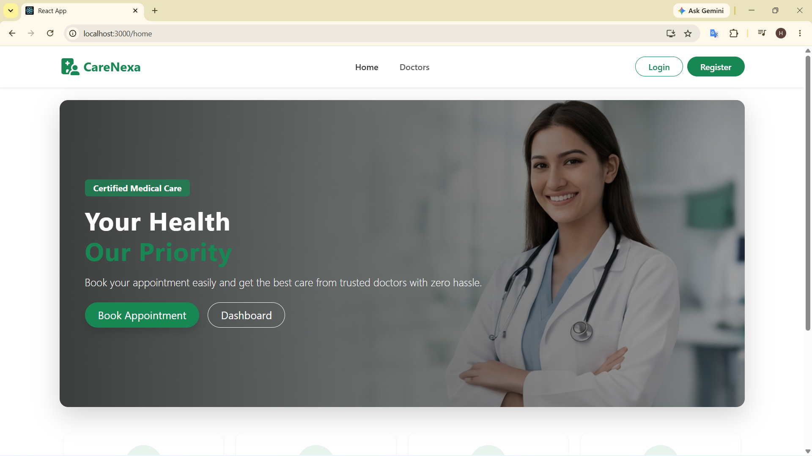
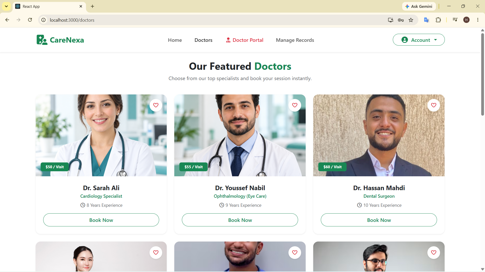
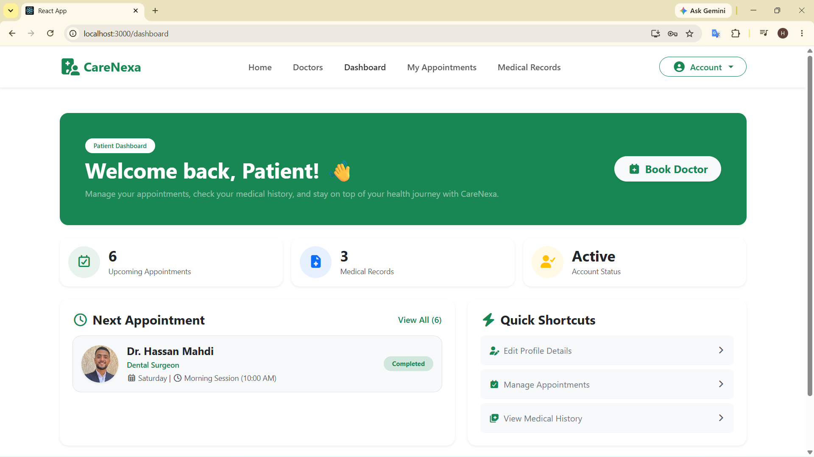
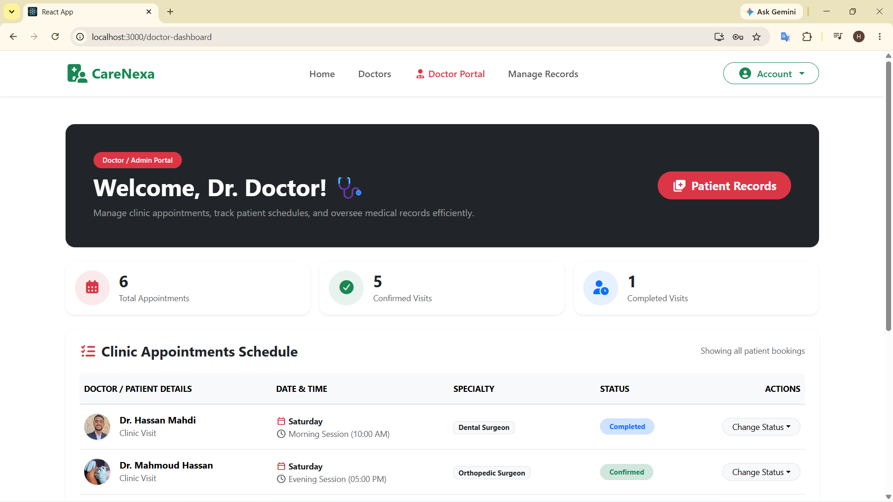
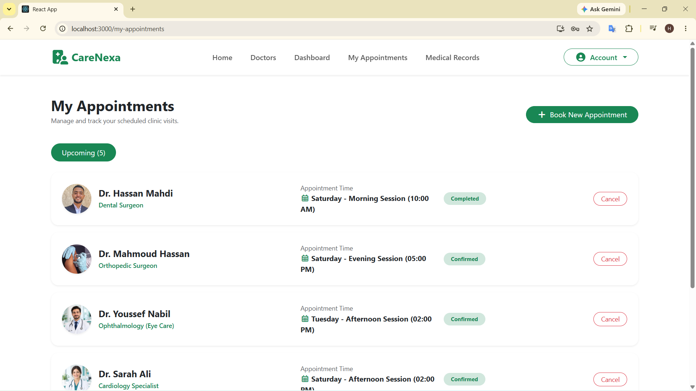
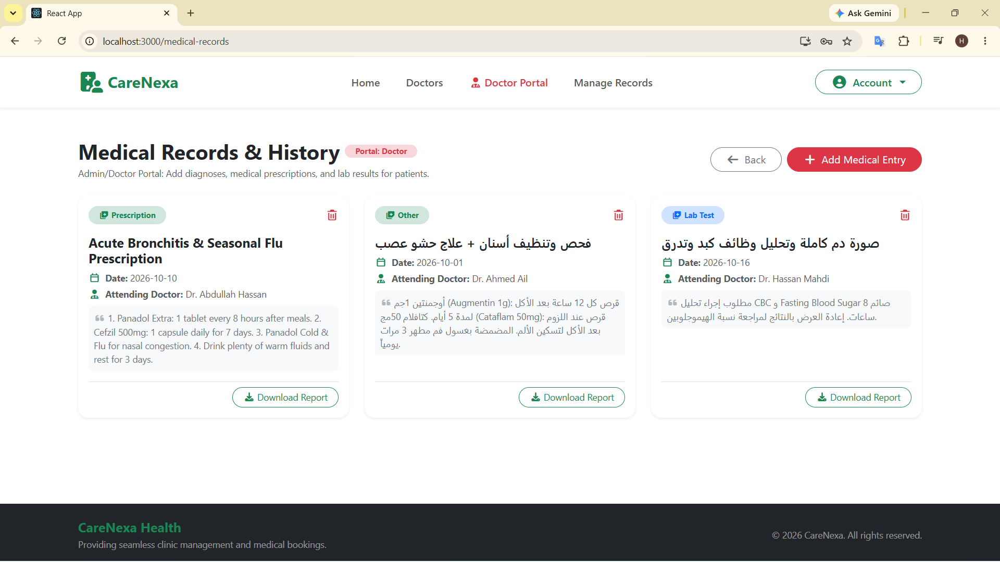

<div align="center">

# 🏥 CareNexa

### Clinic Booking & Healthcare Management System

CareNexa is a responsive healthcare web application designed to simplify the interaction between patients and doctors. It provides an intuitive platform for discovering doctors, booking appointments, managing schedules, and viewing medical records.

Built with **React.js, Bootstrap 5, Formik, and React Router v6**, CareNexa demonstrates modern frontend development practices, role-based navigation, form validation, and client-side data persistence.


[Live Demo](#) · [Report Bug](https://github.com/hassanMahdi-2002/carenexa-clinic-system/issues) · [Request Feature](https://github.com/hassanMahdi-2002/carenexa-clinic-system/issues)

</div>

---

## 📑 Table of Contents
- [Key Features](#-key-features)
- [Tech Stack](#️-tech-stack)
- [Project Architecture](#-project architecture)
- [Getting Started](#-getting-started)
- [Demo Credentials](#-demo-credentials)
- [Screenshots](#-screenshots)
- [Roadmap](#️-roadmap)
- [Contributing](#-contributing)
- [Project-Goals](#-project-goals)
- [Implementation-Notes](#-implementation-notes)
- [Author](#-author)

## ✨ Key Features

### 🔐 Authentication & Role-Based Navigation
- **Multi-Role Registration:** Create accounts as a patient or doctor, according to the supported registration flow.
- **Login & Registration:** User authentication interfaces with form validation.
- **Protected Routes:** Restrict access to specific pages based on the current user's role.
- **Persistent Client-Side Data:** Store registered users and session information using browser `localStorage`.

### 🩺 Patient Portal
- **Doctor Directory:** Browse doctors and explore their medical specialties.
- **Doctor Profiles:** View doctor information and available appointment options.
- **Appointment Booking:** Select appointment dates and times, with availability checks based on locally stored appointment data.
- **Patient Dashboard:** View upcoming appointments, appointment summaries, and quick actions.
- **Appointment Management:** Review booked appointments and their statuses.
- **Medical Records:** View available diagnoses, prescriptions, and medical reports.

### 👨‍⚕️ Doctor / Admin Management
- **Appointment Management:** Review scheduled visits and manage appointment statuses.
- **Status Updates:** Mark appointments as confirmed, completed, or cancelled.
- **Medical Record Management:** Add diagnoses, prescriptions, and test results through the supported management interface.
- **Schedule Overview:** Review appointment information to help organize clinic visits.

---

## 🛠️ Tech Stack

| Technology | Purpose |
|---|---|
| React.js | Component-based user interface |
| JavaScript (ES6+) | Application logic and interactivity |
| Bootstrap 5 | Responsive layout and UI styling |
| Formik | Form state management and validation |
| React Router v6 | Client-side routing and navigation |
| Font Awesome 6 | Icons and visual elements |
| Browser `localStorage` | Client-side data persistence |

---

## 🏗️ Project Architecture

```text
src/
├── Components/
│   ├── Booking/              # Appointment booking interface
│   ├── DoctorDashboard/      # Doctor and management dashboard
│   ├── DoctorDetails/        # Detailed doctor profiles
│   ├── Doctors/              # Doctor directory and specialty filtering
│   ├── Home/                 # Landing page and service highlights
│   ├── Layout/               # Shared layout components
│   ├── Login/                # Login interface
│   ├── MedicalRecords/       # Patient medical records
│   ├── MyAppointments/       # Appointment listing and management
│   ├── Navbar/               # Role-aware navigation
│   ├── PatientDashboard/     # Patient overview dashboard
│   ├── Profile/              # User profile management
│   ├── ProtectedRoute/       # Client-side route protection
│   └── Register/             # Account registration
├── data/
│   └── DoctorsData.js        # Doctor sample data
├── App.jsx                   # Application routes and configuration
└── index.js                  # Application entry point
```
--- 

## 🚀 Getting Started

Follow these steps to run CareNexa locally.

### Prerequisites

- Node.js and npm
- Git

### Installation

1. Clone the repository:

   ```bash
   git clone https://github.com/hassanMahdi-2002/carenexa-clinic-system.git
   ```

2. Navigate to the project directory:

   ```bash
   cd carenexa-clinic-system
   ```

3. Install dependencies:

   ```bash
   npm install
   ```

4. Start the development server:

   ```bash
   npm start
   ```

5. Open the local URL displayed in your terminal. For a standard Create React App setup, this is usually:

   ```text
   http://localhost:3000
   ```
---

## 🔑 Demo Credentials

> Replace these with real values from your project, or register new accounts from the **Register** page.

| Role | Email | Password |
|---|---|---|
| Patient | `patient@example.com` | `123456` |
| Doctor / Admin | `doctor@example.com` | `123456` |

---

## 📸 Screenshots

| Home Page | Doctors Directory |
|:---:|:---:|
|  |  |

| Patient Dashboard | Doctor Dashboard |
|:---:|:---:|
|  |  |

| My Appointments | Medical Records |
|:---:|:---:|
|  |  |

---

## 🗺️ Roadmap

- [x] Role-based authentication
- [x] Doctor directory with specialty filter
- [x] Appointment booking & status management
- [x] Medical records (diagnoses, prescriptions, reports)
- [ ] Backend integration (Node.js / Express + MongoDB)
- [ ] JWT authentication with password hashing
- [ ] Email / SMS appointment reminders
- [ ] Multi-language support (EN / AR) with RTL
- [ ] Dark mode
- [ ] Online payments

---

## 🤝 Contributing

Contributions are welcome!

1. Fork the project
2. Create your feature branch: `git checkout -b feature/amazing-feature`
3. Commit your changes: `git commit -m "Add amazing feature"`
4. Push to the branch: `git push origin feature/amazing-feature`
5. Open a Pull Request

---


## 🎯 Project Goals

CareNexa was built to demonstrate practical frontend development skills, including:

- Building reusable React components.
- Implementing client-side routing and role-aware navigation.
- Handling and validating forms.
- Managing application state and persisted browser data.
- Creating responsive interfaces with Bootstrap.
- Organizing a multi-page application into maintainable components.

## ⚠️ Implementation Notes

- **Client-Side Storage:** User, appointment, and medical-record data are stored locally in the browser. Data is not automatically synchronized across devices or users.
- **Demo Authentication:** Client-side authentication and protected routes are intended for demonstration purposes and do not provide production-grade security.
- **Backend Integration:** A production deployment would require a secure backend, server-side authentication and authorization, and a database with appropriate access controls.
- **Medical Data:** Use fictional sample data only. Do not store real patient information in this demonstration application.


## 👨‍💻 Author

**Hassan Mahdi**

- GitHub: [@hassanMahdi-2002](https://github.com/hassanMahdi-2002)
- Project Repository: [CareNexa Clinic System](https://github.com/hassanMahdi-2002/carenexa-clinic-system)

---

<div align="center">

Created with ❤️ for professional healthcare management.

⭐ If you like this project, give it a star!

</div>

